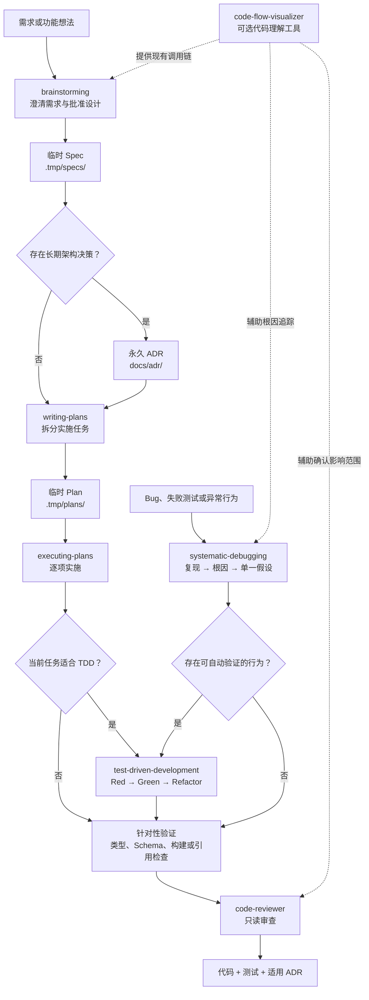

# Pi DevFlow

面向 [Pi](https://pi.dev) 的开发工作流包，将需求澄清、临时规格、实施计划、条件式 TDD、系统调试、代码审查和代码流可视化组合成一套可按需加载的 Skills。

## 能力

- 先澄清设计，再进入实现
- Spec 和 Plan 只作为临时工作材料，不污染长期文档
- 仅把长期架构决策保留为 ADR
- 按任务行为与回归风险决定是否使用 TDD
- 调试时先复现和定位根因，再实施修复
- 支持已提交范围和未提交工作区的只读代码审查
- 基于真实调用关系生成可追溯到源码的交互流程图

## 安装

### GitHub

```bash
pi install git:github.com/xuzhen97/pi-devflow
```

锁定版本：

```bash
pi install git:github.com/xuzhen97/pi-devflow@v0.1.0
```

仅在当前项目启用：

```bash
pi install git:github.com/xuzhen97/pi-devflow -l
```

### 本地仓库

```bash
pi install ./pi-devflow
```

也可以使用绝对路径：

```bash
pi install /absolute/path/to/pi-devflow
```

> Pi 扩展拥有当前用户的系统权限。安装第三方 Pi Package 前应先审查源码。

## Skills

Pi 会根据描述自动加载匹配的 Skill，也可以手动调用：

| Skill | 手动调用 | 用途 |
| --- | --- | --- |
| Brainstorming | `/skill:brainstorming` | 澄清需求、比较方案、批准设计并生成临时 Spec |
| Writing Plans | `/skill:writing-plans` | 将已批准的 Spec 转换为临时实施计划，并逐任务选择测试策略 |
| Executing Plans | `/skill:executing-plans` | 按计划逐项实现、验证和处理阻塞 |
| Test-Driven Development | `/skill:test-driven-development` | 为具有真实行为回归风险的任务执行 Red-Green-Refactor |
| Systematic Debugging | `/skill:systematic-debugging` | 复现故障、追踪根因、验证单一假设并实施回归修复 |
| Code Reviewer | `/skill:code-reviewer` | 对 commit 范围或 staged、unstaged、untracked 工作区执行只读审查 |
| Code Flow Visualizer | `/skill:code-flow-visualizer` | 分析真实调用链并生成可跳转源码的交互 HTML 流程图 |

修改 Skill 后，可在 Pi 中执行 `/reload` 重新发现资源。

扩展还提供状态检查命令：

```text
/devflow
```

## 技能关系



关系说明：

- `brainstorming`、`writing-plans` 和 `executing-plans` 构成功能交付主路径。
- `test-driven-development` 是逐任务选择的执行策略，不是所有任务的强制步骤。
- `systematic-debugging` 是故障入口；确认根因后，有可测试行为时进入 TDD，否则使用合适的非测试验证。
- `code-reviewer` 是实现后的质量门槛，不负责修改代码。
- `code-flow-visualizer` 是可选的代码理解工具，可辅助设计、调试和审查，不阻塞主流程。

## 文档生命周期

```text
.tmp/specs/   临时规格
.tmp/plans/   临时实施计划
docs/adr/     永久架构决策记录
```

规则：

- `.tmp/` 已被 Git 忽略，不进入 npm 发布包。
- Spec 和 Plan 是执行期间的工作记忆，完成后可以删除。
- 代码和测试是实现行为的事实来源。
- ADR 只保留长期约束系统边界、公共接口、数据、安全、基础依赖或部署方式的决策。
- ADR 记录背景、决策、后果和主要替代方案，不复制 Spec 或 Plan。

当前 ADR：

- [`2026-08-26-temporary-specs-and-plans.md`](docs/adr/2026-08-26-temporary-specs-and-plans.md)
- [`2026-08-26-conditional-tdd-by-task.md`](docs/adr/2026-08-26-conditional-tdd-by-task.md)

## 条件式 TDD

`writing-plans` 必须为每个任务声明测试策略：

```markdown
**Test strategy:** TDD: Required
**Reason:** 该任务修改了解析分支，错误实现会产生可观察的错误结果。
```

或者：

```markdown
**Test strategy:** TDD: Not applicable
**Reason:** 该任务只修改人工阅读的文档，不存在有意义的 Red/Green 行为周期。
```

通常需要 TDD：

- 业务规则、分支、解析和状态转换
- API、持久化、安全、并发和资金逻辑
- Bug 修复及具有行为回归风险的重构

通常不强制 TDD：

- 人工阅读的文档和 ADR 文案
- 不包含自定义运行逻辑的声明式元数据
- 生成文件、格式化和精确机械修改

不使用 TDD 仍必须提供适合的验证，例如类型检查、Schema 校验、构建、Lint、引用搜索或权威生成器检查。

## 项目结构

```text
pi-devflow/
├── docs/
│   └── adr/                       # 永久架构决策
├── extensions/
│   └── index.ts                   # /devflow 状态命令
├── skills/
│   ├── brainstorming/
│   ├── code-flow-visualizer/
│   ├── code-reviewer/
│   ├── executing-plans/
│   ├── systematic-debugging/
│   ├── test-driven-development/
│   └── writing-plans/
├── package.json
├── README.md
└── tsconfig.json
```

`package.json` 显式声明 Pi 资源：

```json
{
  "pi": {
    "extensions": ["./extensions/index.ts"],
    "skills": ["./skills"]
  }
}
```

## 本地开发

```bash
git clone https://github.com/xuzhen97/pi-devflow.git
cd pi-devflow
npm install
npm run check
pi -e ./extensions/index.ts
```

发布前检查：

```bash
npm run check
npm pack --dry-run
```

## 更新与卸载

```bash
pi update git:github.com/xuzhen97/pi-devflow
pi remove git:github.com/xuzhen97/pi-devflow
```

项目级安装在命令末尾添加 `-l`。

## License

[MIT](./LICENSE)
