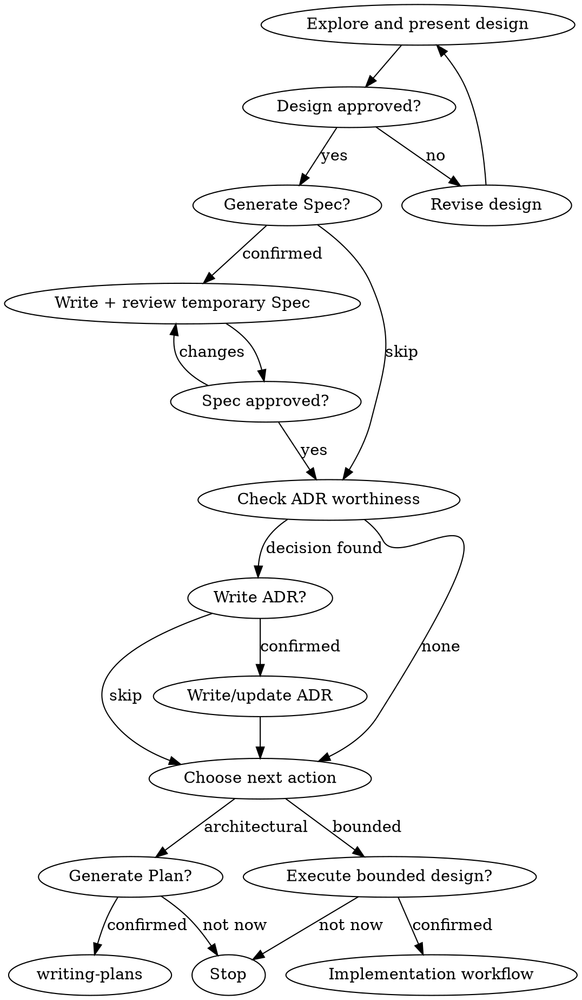

# Brainstorming Ideas Into Designs

Help turn ideas into fully formed designs and specs through natural collaborative dialogue.

Start by classifying how much process the request needs, then work
through your path: understand the context, refine the idea, present a
design, and get your human partner's approval.

<HARD-GATE>
Brainstorming is read-only with respect to implementation files. It may
inspect the repository, ask questions, and present designs, but it MUST
NOT write code, edit configuration, scaffold files, or invoke an
implementation workflow until the user passes the relevant confirmation
gate below.

These approvals are independent and single-purpose:

1. approve the design
2. generate a temporary Spec
3. create or update an ADR
4. generate a temporary Plan
5. execute the approved Plan or bounded design

Approval never carries forward. Design approval does not authorize a
Spec; Spec approval does not authorize an ADR or Plan; Plan creation or
approval does not authorize execution. A broad opening request such as
"build this" or "plan and implement this" does not bypass later gates.
Ask one closed confirmation question, end the message, and wait. An
unambiguous yes directly answering that question authorizes only the
named action.
</HARD-GATE>

## Three Paths

Before your first question, classify the request and say the
classification out loud — "this looks bounded, so I'll present a short
design here rather than write a spec" — so your human partner can
override it:

- **Spike** — a feasibility question ("can we...", "is it possible...",
  "quick and dirty is fine") whose output is an answer, not code you
  keep. Present the question and read-only probe in 2-3 sentences and
  get approval before investigating. If the probe must create or modify
  files, ask separately for that exact temporary action. Report findings
  as a recommendation; never silently promote probe code into production.
- **Bounded** — a well-scoped change to an existing flow: a new flag, a
  small endpoint, or a one-file fix. Ask the questions that matter and
  present a short design IN CHAT. After design approval, ask whether to
  write a temporary Spec; recommend skipping it when chat is sufficient,
  but let the user decide. Check the ADR gate, then ask whether to execute
  the approved bounded design. STOP until execution is explicitly
  confirmed. A Plan is normally unnecessary.
- **Architectural** — new projects, new subsystems, changed system
  boundaries, or public interface changes. Follow the full process:
  questions, approaches, sectioned design, design approval, optional
  Spec confirmation, ADR confirmation when applicable, and Plan
  confirmation. Plan execution is confirmed later and separately.

When in doubt between two paths, take the heavier one. The ratchet is
one-way: hidden complexity discovered mid-task upgrades the path —
stop, say so, and step up. Nothing downgrades mid-task.

## Anti-Pattern: "Too Simple To Need Approval"

Every implementation path requires a fresh execution confirmation. A
todo item, single-function utility, or config change may need only a
two-sentence design, but design approval is not execution approval.
What scales with simplicity is the artifact, never the gate.

## Red Flags

| Thought | Reality |
|---------|---------|
| "This is too simple to need a design" | Simple means a short design, not no design. |
| "They approved the design, so I can write the Spec" | Ask whether to generate the Spec; design approval does not authorize file creation. |
| "The Spec contains an architectural decision, so I should record it" | Explain the proposed ADR and ask whether to write it first. |
| "They asked me to plan and implement, so I can run the Plan immediately" | Finish the Plan, summarize it, then ask separately whether to execute it. |
| "They said continue earlier" | Only a direct answer to the current closed gate counts. |
| "The spike works, so I'll keep the code" | Keeping probe code is a new implementation action and needs confirmation. |
| "It grew, but I'm almost done" | Hidden complexity invalidates execution approval; stop and confirm the changed scope. |

## Confirmation Protocol

At every gate:

1. State the exact action and target path or scope.
2. Ask one closed confirmation question as the final line of the message.
3. Stop. Do not call tools that perform the gated action in that turn.
4. Accept only an unambiguous answer to that current question.
5. Perform only the confirmed action, then stop at the next gate.

Recommended prompts:

- Spec: `Design approved. Generate the temporary Spec at <path>? (generate / skip)`
- ADR: `This introduces <decision>. Write or update <ADR path>? (write / skip)`
- Plan: `Generate a temporary implementation Plan from the approved design? (generate / not now)`
- Bounded execution: `Begin modifying implementation files for this approved bounded design? (execute / not now)`

If the answer is unclear, ask again. Refusal or silence means do nothing.

## Checklist

Classify first, announce the path, then complete its gates in order.

**Spike:**
1. Explore enough project context to frame the probe.
2. Present the question and read-only probe plan.
3. Ask for probe confirmation and wait.
4. Investigate as cheaply as correctness allows.
5. Report findings; ask separately before creating probe files or keeping probe code.

**Bounded:**
1. Explore context and ask the necessary questions.
2. Present the short design in chat.
3. Ask for design approval and wait.
4. Ask whether to generate a temporary Spec and wait; write it only if confirmed.
5. Run the ADR-worthiness check. If a decision qualifies, propose the ADR and ask whether to write it; otherwise state that no ADR is needed.
6. Ask whether to execute the approved bounded design and wait.
7. Only after execution confirmation, hand off to the normal implementation workflow. Do not create a Plan unless the user asks for one.

**Architectural:**
1. Explore context, ask questions, compare approaches, and present the design in reviewable sections.
2. Ask for final design approval and wait.
3. Ask whether to generate a temporary Spec and wait.
4. If confirmed, write and self-review the Spec, then ask the user to approve its contents.
5. Run the ADR-worthiness check. For each qualifying decision, present its proposed title and summary and ask whether to write or update the ADR. Wait before changing `docs/adr/`.
6. Ask whether to generate a temporary implementation Plan and wait.
7. If confirmed, invoke `writing-plans`. Never invoke an implementation workflow from brainstorming.

## Process Flow



**Approvals are path-bound and action-bound.** Brainstorming can end with a recommendation, an approved chat design, a temporary Spec, an optional ADR, or a handoff to `writing-plans`. It must never slide from one state into implementation without the next explicit confirmation.

## The Process

The subsections below serve the bounded and architectural paths (a
spike stops at "present the probe, get a nod"). Sections from
**Exploring approaches** onward are architectural-path depth — for
bounded work, context plus a few questions plus a short in-chat design
is the whole process.

**Understanding the idea:**

- Check out the current project state first (files, docs, recent commits)
- Before asking detailed questions, assess scope: if the request describes multiple independent subsystems (e.g., "build a platform with chat, file storage, billing, and analytics"), flag this immediately. Don't spend questions refining details of a project that needs to be decomposed first.
- If the project is too large for a single spec, help the user decompose into sub-projects: what are the independent pieces, how do they relate, what order should they be built? Then brainstorm the first sub-project through the normal design flow. Each sub-project gets its own spec → plan → implementation cycle.
- For appropriately-scoped projects, ask questions one at a time to refine the idea
- Prefer multiple choice questions when possible, but open-ended is fine too
- Only one question per message - if a topic needs more exploration, break it into multiple questions
- Focus on understanding: purpose, constraints, success criteria

**Exploring approaches:**

- Propose 2-3 different approaches with trade-offs
- Present options conversationally with your recommendation and reasoning
- Lead with your recommended option and explain why
- YAGNI ruthlessly - remove unnecessary features from every approach and design

**Presenting the design:**

- Once you believe you understand what you're building, present the design
- Scale each section to its complexity: a few sentences if straightforward, up to 200-300 words if nuanced
- Ask after each section whether it looks right so far
- Cover: architecture, components, data flow, error handling, testing
- Be ready to go back and clarify if something doesn't make sense

**Design for isolation and clarity:**

- Break the system into smaller units that each have one clear purpose, communicate through well-defined interfaces, and can be understood and tested independently
- For each unit, you should be able to answer: what does it do, how do you use it, and what does it depend on?
- Can someone understand what a unit does without reading its internals? Can you change the internals without breaking consumers? If not, the boundaries need work.
- Smaller, well-bounded units are also easier for you to work with - you reason better about code you can hold in context at once, and your edits are more reliable when files are focused. When a file grows large, that's often a signal that it's doing too much.

**Working in existing codebases:**

- Explore the current structure before proposing changes. Follow existing patterns.
- Where existing code has problems that affect the work (e.g., a file that's grown too large, unclear boundaries, tangled responsibilities), include targeted improvements as part of the design - the way a good developer improves code they're working in.
- Don't propose unrelated refactoring. Stay focused on what serves the current goal.

## After the Design (architectural path)

**Temporary specification:**

After design approval, propose `.tmp/specs/YYYY-MM-DD-<topic>-design.md` and ask whether to generate it. STOP and wait. Only after confirmation:

- Create `.tmp/specs/` when needed and write the validated design.
- Honor a user-specified alternative location.
- Treat the Spec as working memory: do not commit it; it may be deleted after implementation.
- Keep code and tests as the implementation authority.

If the user skips the Spec, continue from the approved chat design. Skipping it does not authorize an ADR, Plan, or implementation.

**Spec Self-Review:**
After writing the spec document, look at it with fresh eyes:

1. **Placeholder scan:** Any "TBD", "TODO", incomplete sections, or vague requirements? Fix them.
2. **Internal consistency:** Do any sections contradict each other? Does the architecture match the feature descriptions?
3. **Scope check:** Is this focused enough for a single implementation plan, or does it need decomposition?
4. **Ambiguity check:** Could any requirement be interpreted two different ways? If so, pick one and make it explicit.

Fix any issues inline. No need to re-review — just fix and move on.

**User Review Gate:**
After the Spec review loop passes, ask the user to review it:

> `Spec written to <path>. Do you approve its contents? (approve / request changes)`

STOP and wait. Requested changes require another review. Spec approval authorizes neither ADR creation nor Plan generation.

**ADR Preservation Gate:**

After the user approves the spec, inspect it for decisions that future maintainers must understand even after the temporary spec and plan are deleted.

Create or update an ADR in `docs/adr/` when a decision:

- changes system or module boundaries
- establishes a public interface, data contract, or persistence model
- selects a foundational dependency, protocol, runtime, deployment, or security approach
- introduces a cross-cutting convention
- is expensive or risky to reverse

Do **not** create ADRs for file lists, implementation steps, minor naming choices, ordinary library usage, or temporary workarounds. If nothing qualifies, say `No ADR-worthy decisions in this design` and continue to the next confirmation gate.

When a decision qualifies:

1. Search `docs/adr/` for an existing decision.
2. Present the proposed title, concise decision summary, and target path.
3. Ask whether to create, update, or supersede that ADR.
4. STOP and wait. Do not edit `docs/adr/` until confirmed.
5. If declined, state that the decision will not be preserved as an ADR and continue without writing it.

Use one decision per file:

```text
docs/adr/YYYY-MM-DD-<decision-slug>.md
```

Every ADR must be concise and contain:

```markdown
# [Decision title]

- Status: Accepted
- Date: YYYY-MM-DD

## Context
[Why a durable decision was needed.]

## Decision
[The decision, stated directly.]

## Consequences
[Important benefits, costs, constraints, and follow-up obligations.]

## Alternatives considered
[Serious alternatives and why they were not selected.]
```

An ADR records **why and constraints**, not a copy of the Spec or Plan. Do not link it only to `.tmp/` files because those links will become stale. ADRs are permanent, tracked documentation; never create, commit, or update one without the corresponding approval. If ADR extraction reveals an unapproved design decision, return to design review.

**Plan and implementation handoff:**

- For architectural work, ask whether to generate a Plan and wait. Only after confirmation invoke `writing-plans` or create the Plan using the project's normal workflow.
- `writing-plans` must stop after creating and summarizing the Plan, then ask whether to execute it.
- For bounded work without a Plan, ask directly whether to execute the approved design and wait.
- Never invoke an implementation skill in the same turn that asks for execution confirmation.
- Material scope changes invalidate execution approval and return to the appropriate design gate.

## Visual Companion

A browser-based companion for showing mockups, diagrams, and visual options during brainstorming. Available as a tool — not a mode. Accepting the companion means it's available for questions that benefit from visual treatment; it does NOT mean every question goes through the browser.

**Offering the companion (just-in-time):** Do NOT offer it upfront. Wait until a question would genuinely be clearer shown than told — a real mockup / layout / diagram question, not merely a UI *topic*. The first time that happens, offer it then, as its own message:
> "This next part might be easier if I show you — I can put together mockups, diagrams, and comparisons in a browser tab as we go. It's still new and can be token-intensive. Want me to? I'll open it for you."

**This offer MUST be its own message.** Only the offer — no clarifying question, summary, or other content. Wait for the user's response. If they accept, start the server with `--open` so their browser opens to the first screen automatically. If they decline, continue text-only and don't offer again unless they raise it.

**Per-question decision:** Even after the user accepts, decide FOR EACH QUESTION whether to use the browser or the terminal. The test: **would the user understand this better by seeing it than reading it?**

- **Use the browser** for content that IS visual — mockups, wireframes, layout comparisons, architecture diagrams, side-by-side visual designs
- **Use the terminal** for content that is text — requirements questions, conceptual choices, tradeoff lists, A/B/C/D text options, scope decisions

A question about a UI topic is not automatically a visual question. "What does personality mean in this context?" is a conceptual question — use the terminal. "Which wizard layout works better?" is a visual question — use the browser.

If they agree to the companion, read the detailed guide before proceeding:
`visual-companion.md`
